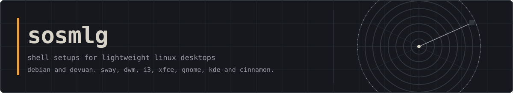

  

### 👋 Hey, I'm SOSMLG — I make Linux desktops feel effortless.

I write shell scripts and setup guides for **lightweight, good-looking desktops** on Debian & Devuan.
From reviving old ThinkCentres to tuning Sway and dwm, I like software that stays fast and does one thing well.

## 📈 GitHub at a glance

<table>
  <tr>
    <td></td>
    <td></td>
  </tr>
  <tr>
    <td></td>
    <td align="left" valign="middle">
<b>🎯 Right now</b> 
• Refining Sway &amp; dwm setups 
• Writing Debian / Devuan guides 
• Breathing new life into old PCs 
• Automating the boring parts with shell
    </td>
  </tr>
</table>

## 🛠️ Tools of the trade

## 🚀 Featured projects

<table>
  <tr>
    <td align="center"></td>
    <td align="center"></td>
  </tr>
  <tr>
    <td align="center"></td>
    <td align="center"></td>
  </tr>
  <tr>
    <td align="center"></td>
    <td align="center"></td>
  </tr>
</table>

  📦 <a href="https://github.com/SOSMLG?tab=repositories"><b>Browse all 10 repositories</b></a>

### More from the workshop

- **[DevuanSway](https://github.com/SOSMLG/DevuanSway)** — Sway setup for Devuan with OpenRC
- **[Devuan-Kde](https://github.com/SOSMLG/Devuan-Kde)** — KDE desktop setup for Devuan
- **[SetupForWinIotEnterprise](https://github.com/SOSMLG/SetupForWinIotEnterprise)** — Windows IoT Enterprise setup scripts

## 💬 Let's connect

- **GitHub:** [@SOSMLG](https://github.com/SOSMLG) — follow me or open an issue on any repo
- **Ideas & fixes:** pull requests are always welcome
- ⭐ If a setup saved you an afternoon, star the repo — it keeps the motivation going

  Built with shell scripts, a little caffeine, and a soft spot for fast desktops. ☕

